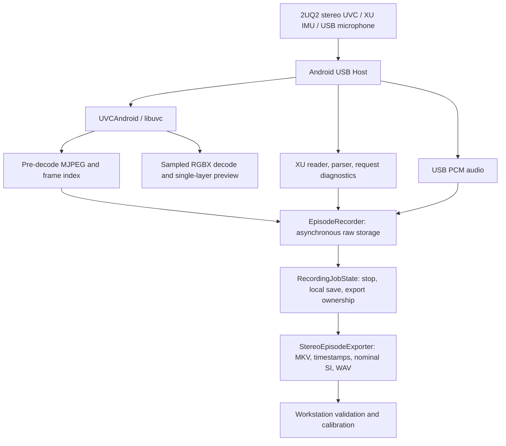

# Ego Capture (EgoStereoIMU)

This branch includes the **code17 single-page UI** with automatic preview and idle IMU reads. APK build and phone acceptance are pending; see [the UI notes](docs/SINGLE_PAGE.zh-CN.md).

**An Android egocentric stereo, IMU and USB-audio recorder.**

[简体中文](README.md) · [Stereo calibration tools](https://github.com/EgoOneLabs/Ego-Calib-Tools/tree/feat/ego-stereo-calibration/ego_stereo) · [Detailed evidence/handoff](docs/STATUS-20261106.md)

An Android USB Host phone connects to a 2UQ2 headband over OTG, previews continuously, saves raw multimodal Episodes, then exports stereo MKV, IMU and audio. Calibration runs on the workstation, not inside the app.

> **Work in progress: basic capture works; reliability and timing acceptance remain open.** Branch `feat/android-capture-code16`, code16 / `0.3.5-capture-ui`, package `com.egouvc.phone`. Updated 2026-11-06; historical device/build evidence is from November 3–4. A successful short session does not certify every device or long-term reliability.

## Features and status

| Feature | Implementation | Verification / remaining work |
|---|---|---|
| USB Host permissions | 2UQ2 `1bcf:0b15` | Used on the target phone; other phones not systematically tested |
| Stereo preview | Continuous sampled 5–10 FPS target; actual drawn FPS | User confirmed code15 ghosting fix; distinct from recording rate |
| Raw MJPEG recording | Pre-decode bytes, frame index and original timing fields | Actual media readback completed; production recording does not re-encode preview RGBX |
| Saved frame rate | 30/15/10 FPS targets and actual-rate metrics | Strict constant 30 FPS not accepted |
| Stereo export | Lossless coefficient-domain split of 3840×1080 into two 1920×1080 MJPEG MKVs | One real session fully decoded, 286 frames per eye |
| XU IMU | Headband USB packets, original counts and request diagnostics | 7364 samples checked; counter gaps remain |
| Nominal SI export | m/s², rad/s; original counts retained | Row-by-row conversion checked; not per-unit precision calibration |
| Standalone IMU probe | One-shot non-recording device diagnostic | Present; not a continuity or synchronization certificate |
| USB audio | PCM/WAV with index and metadata | One 48 kHz stereo PCM16 WAV decoded successfully |
| Local save/export state | Job ownership independent of USB session | One stop-then-unplug export passed; reconnect combinations remain open |
| UI | Bilingual cards, fixed recording controls, expandable details | Simplified code16 UI confirmed; historical calibration viewer/assets removed |
| Hardware synchronization / camera–IMU calibration | Not accepted | Separate follow-up work |

## Architecture



Preview may decode/downsample; production capture stores camera MJPEG bytes. After stopping, original JPEG coefficients are split without resizing or requantization. A newly opened USB session must not prematurely unlock an old export job.

| Source | Responsibility |
|---|---|
| [`MainActivity.kt`](app/src/main/java/com/egouvc/phone/MainActivity.kt) | UI, permissions, Surface lifecycle; `onStop()` closes the camera |
| [`camera/`](app/src/main/java/com/egouvc/phone/camera/) | UVC lifecycle, raw/decoded callbacks, preview/FPS |
| [`recording/`](app/src/main/java/com/egouvc/phone/recording/) | Raw storage, IMU diagnostics, audio and job state |
| [`export/`](app/src/main/java/com/egouvc/phone/export/) | JPEG splitting, MKV, output contract, SI/time mapping |
| [`third_party/uvcandroid/`](third_party/uvcandroid/) | Native UVC/USB and original video-timing fields |
| [`app/src/test/`](app/src/test/) | Recording, export, IMU-policy and audio regression tests |

## Hardware and build environment

Tested phone: Huawei STG-AL00 with USB Host/OTG. Headband IMU uses USB UVC XU, not Bluetooth or the phone's own IMU. The camera advertises 3840×1080 MJPEG at 60 FPS; this is not proof the phone saves 30 FPS. CAMERA, USB-device and RECORD_AUDIO permissions are required.

JDK17; Gradle8.7; AGP8.6.1; Kotlin1.9.24; SDK35; NDK `27.3.13750724`; minSdk31, compileSdk35, targetSdk35.

## Quick start — Linux workstation

```bash
git clone --branch feat/android-capture-code16 https://github.com/EgoOneLabs/Ego-Capture.git
cd Ego-Capture
printf 'sdk.dir=%s\n' "$HOME/Android/Sdk" > local.properties
./gradlew :app:testDebugUnitTest :app:assembleDebug --no-daemon --max-workers=4 --console=plain
adb devices -l
adb install --no-streaming -r app/build/outputs/apk/debug/app-debug.apk
adb shell am start -n com.egouvc.phone/.MainActivity
```

With multiple phones, add `-s ACTUAL_SERIAL` to adb commands. Updating an installed app requires the same signing key. Preserve the workstation's debug keystore; keys are not in Git. Do not uninstall merely to bypass a signature mismatch, which may destroy local recordings.

Reconnect the headband after installation, grant permissions, open the camera, enter task/device labels, select a target rate, record and stop/save. Keep the app in the foreground until export completes. The entered device label is not verified calibration-unit binding.

## Episode format and time semantics

App-specific root: `/storage/emulated/0/Android/data/com.egouvc.phone/files/`.

| Location | Important files |
|---|---|
| `episodes/episode_*` | `video.mjpg`, `video_index.csv`, `video_uvc_timing.csv`, `imu_packets.bin`, `imu_packets.csv`, `imu_samples.csv`, `imu_attempts.csv`, `imu_diagnostics.json`, audio WAV/index/metadata, `metadata.json`, `quality.json` |
| `data/TASK/DEVICE_SESSION/videos/` | `left.mkv`, `right.mkv` |
| Export `timestamps/` | `left_timestamps.txt`, `right_timestamps.txt`: saved frame index and Unix seconds with nine fractional digits |
| Export `imu/` | `imu0.csv` (11 columns), `imu_raw_counts.csv` |
| Export `audio/` | WAV when recording succeeded, plus metadata/index; check status rather than assuming audio always succeeded |
| Export root | `meta.json`, `export_video_index.csv`, `export_skipped_frames.csv` |

IMU: 252 bytes per packet, fourteen 18-byte records containing header, raw 32-bit counter and six 16-bit axes. Nominal scales: 4096 count/g and 16.4 count/(degree/s), converted with standard gravity 9.80665 and radians. No per-unit bias/scale calibration or sensor-to-camera axis transform is applied; accelerometer data retains gravity response.

Video time is host callback-receive `CLOCK_BOOTTIME`. IMU records host USB-request start/end; export uses their midpoint, shared by all fourteen samples in the packet. Unix mapping does not create device sample/exposure timestamps. Raw device-clock fields are preserved without claiming verified semantics.

Four zero orientation columns mean **orientation unavailable**, not a valid quaternion. The file contract is a structural reference, not proof of Kalibr camera–IMU readiness or four-camera support.

## Completed verification

| Check | Evidence | Scope |
|---|---|---|
| Historical code16 build | 40 JUnit tests / 14 suites, successful workstation build on 2026-11-04 | No fresh Android APK build during November 6 source synchronization |
| Device UI/preview | User confirmed code15 ghosting fix and code16 simplified UI | Does not establish every lifecycle scenario |
| Stop then unplug | One completed local export and consistent metadata/counts | Not recording-time disconnect or reconnect-during-export acceptance |
| Real media | 286 decoded frames per eye; 9.24s, nonzero 48kHz stereo PCM16 WAV | Audio presence is not hardware A/V synchronization |
| Video timing | Relative MKV PTS/text maximum difference 999999ns; maximum frame gap 67.387604ms | Millisecond container precision; not strict constant 30FPS |
| IMU rows | 526×14=7364 samples, counts and nominal SI matched | Original counter gaps remain |

See [source manifest](docs/code16-source-manifest.json) and [status/evidence](docs/STATUS-20261106.md). APKs, signing keys and raw captures are not included.

## Open issues and handoff priorities

| Priority | Open issue | Next evidence required |
|---|---|---|
| High | IMU continuity: 25 observed gaps, estimated 406 missing positions (~5.225%) | Isolate request-service timing/device buffering/counter semantics; one controlled change and retained raw diagnostics |
| High | Individual sample clocks and exposure/IMU sync | Confirm clock/exposure semantics and validate independently; interpolation is not proof |
| High | Long sessions and lifecycle recovery | Test long recording, reconnect, foreground/background and export ownership; verify saved files and logs |
| Medium | Saved-rate stability | Measure actual FPS and interval distribution on the target phone for specified durations |
| Medium | Device/calibration association | Bind a unique physical unit to a parameter version on the workstation |
| Later | Camera–IMU calibration repeatability | Separate diagnostic work; not a prerequisite for the pure-camera workflow |

Do not silently shorten polling sleeps, fabricate samples or emit fake orientation. First confirm branch/APK/signature and read existing evidence. Run build/tests for code changes, preserve failures and inputs, and keep “implemented”, “UI confirmed” and “data-quality accepted” distinct. Existing passed recordings need not be replayed merely because the documentation changes.

## Distributed runtime inputs

The [colleague handoff guide](docs/COLLEAGUE_HANDOFF.zh-CN.md) inventories APK,
source, SDK/NDK, Kalibr image, local packaging and setup steps. A source bundle
does not include an APK; obtain the checksum-verified workstation artifact.

Run `python3 scripts/verify_checkout.py` after cloning to verify the 1,210-file
code16 baseline, Gradle wrapper and native build inputs. Sources, resources and
vendored native components are included; no historical patch ZIP is required.
Generate the current machine's SDK path as described above. See the
[local file inventory](docs/LOCAL_FILES.md). This does not run an APK build or
device acceptance test.

## Licensing and contributions

Issues/PRs on device compatibility, XU IMU, timing and data quality are welcome. No confirmed top-level project LICENSE is present; maintainers must settle project licensing. Preserve each third-party UVC/USB/JPEG component's copyright and license. Third-party licenses do not automatically license all project code.
