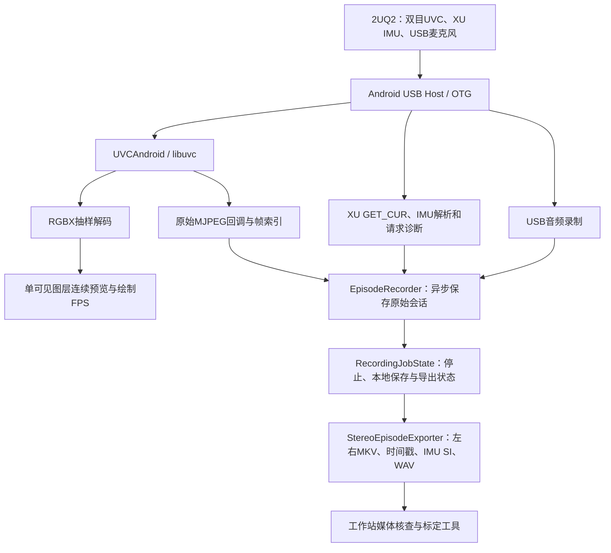

# Ego Capture（EgoStereoIMU）

当前分支包含 **code18 单页界面**，竖屏不滚动、连接后自动预览和读取 IMU。[界面说明与手机验收](docs/SINGLE_PAGE.zh-CN.md)。APK 构建和手机验收结果以构建清单为准。

**面向 Android 的第一视角双目视觉、IMU 与 USB 声音采集 App。**

[English](README.en.md) · [双目标定工具](https://github.com/EgoOneLabs/Ego-Calib-Tools/tree/feat/ego-stereo-calibration/ego_stereo) · [详细阶段记录](docs/STATUS-20261106.md)

手机通过 USB OTG 连接 2UQ2 头环，连续预览并保存视频、六轴 IMU、声音和时间信息，以采集会话（Episode）组织原始数据，停止后导出左右视频和标准目录。相机标定与质量核查由工作站上的 Ego-Calib-Tools 完成。

> **项目状态：基础采集链路已跑通，仍在完善可靠性和时间质量。** 当前开发分支为 `feat/android-capture-code16`，版本 **code16 / 0.3.5-capture-ui**，包名 `com.egouvc.phone`。已验证目标手机与一条短记录，不代表所有手机、长时采集或硬件同步已经验收。文档更新：2026-11-06；下述真机与历史构建证据来自2026-11-03至11-04。

## 功能与当前进度

| 功能 | 已做到哪里 | 验证状态 / 剩余工作 |
|---|---|---|
| USB Host识别与授权 | 适配2UQ2 `1bcf:0b15` | 已有真机使用证据；其他手机兼容性待测 |
| 连续双目预览 | 抽样预览目标5–10FPS，显示实际绘制帧率 | code15修复叠影，用户确认正常；不是保存帧率 |
| 原始MJPEG采集 | 解码前取原始字节、索引及设备时序原字段 | 已有真实视频读回；不再以RGBX重编码JPEG作为正式录制 |
| 保存帧率 | 可选30/15/10FPS目标，独立显示实际值 | 严格稳定30FPS尚未验收 |
| 左右视频导出 | 原始3840×1080无损拆分为两路1920×1080 MJPEG MKV | 一条记录左右各286帧完整解码通过 |
| XU IMU读取与解析 | USB UVC扩展单元读取、原始包/计数、请求诊断 | 已录得7364条；仍有计数间隙 |
| IMU名义SI导出 | m/s²、rad/s，并保留原计数 | 逐行换算已核对；不是单台精密标定 |
| 独立IMU检查 | 设备诊断中的单次读取/解析探测，不录制 | 功能已合并；不能据此证明长时连续性或同步 |
| USB头环声音 | PCM录制、WAV及音频索引/元数据 | 一条48kHz双声道PCM16 WAV读回通过 |
| 停止后本地保存/导出 | 与USB相机连接状态分离 | 一次停止后拔线导出通过；重插等组合场景待测 |
| UI与状态 | 中英文卡片、固定采集按钮、展开保存详情 | 用户确认code16精简界面正常；已移除历史标定展示 |
| 硬件同步、相机—IMU联合标定 | 尚未建立已验收方案 | 不在当前完成范围 |

## 系统架构



预览与正式采集分路：预览允许解码和降频显示；正式视频保存相机原始MJPEG字节，停止后按JPEG系数域拆分左右，不通过预览画面重编码。保存任务有独立归属，不能用新USB会话的状态提前解除旧导出任务的锁。

| 源码入口 | 接手时关注的职责 |
|---|---|
| [`MainActivity.kt`](app/src/main/java/com/egouvc/phone/MainActivity.kt) | 权限、界面状态、按钮、Surface生命周期；`onStop()`会关闭相机 |
| [`camera/`](app/src/main/java/com/egouvc/phone/camera/) | UVC打开/关闭、原始与解码回调、抽样预览、FPS统计 |
| [`recording/`](app/src/main/java/com/egouvc/phone/recording/) | 原始写入、IMU读取/计数质量、音频、本地任务状态 |
| [`export/`](app/src/main/java/com/egouvc/phone/export/) | 左右拆分、MKV、输出契约、SI与时间映射 |
| [`third_party/uvcandroid/`](third_party/uvcandroid/) | UVC/USB原生实现及原始帧时序字段；另含各组件许可 |
| [`app/src/test/`](app/src/test/) | 导出契约、录制状态、IMU策略、音频等测试 |

## 硬件与环境

| 项目 | 当前配置 |
|---|---|
| 头环 | 2UQ2，VID:PID `1bcf:0b15`；IMU走USB UVC XU，不是蓝牙或手机内置IMU |
| 手机 | 华为STG-AL00，支持USB Host/OTG；其他型号尚未系统验收 |
| 视频 | 设备声明3840×1080 MJPEG 60FPS；App保存目标30/15/10FPS，两者不能混为实测值 |
| Android | minSdk31、compileSdk35、targetSdk35 |
| Java / 构建 | JDK17、Gradle8.7、AGP8.6.1、Kotlin1.9.24 |
| SDK / NDK | Android SDK35、NDK `27.3.13750724` |
| 采集权限 | CAMERA、USB设备授权、RECORD_AUDIO |
| 工作站 | 构建需Android工具链；数据核查/标定另需FFmpeg及Kalibr容器 |

## 快速开始（Linux工作站）

首次克隆到新目录；已有工程先检查本地修改，不直接覆盖。

```bash
git clone --branch feat/android-capture-code16 https://github.com/EgoOneLabs/Ego-Capture.git
cd Ego-Capture
printf 'sdk.dir=%s\n' "$HOME/Android/Sdk" > local.properties
./gradlew :app:testDebugUnitTest :app:assembleDebug --no-daemon --max-workers=4 --console=plain
```

APK：`app/build/outputs/apk/debug/app-debug.apk`。手机先连接工作站并允许USB调试，确认设备后覆盖安装：

```bash
adb devices -l
# 【多台设备时修改】在adb后添加 -s 实际序列号。
adb install --no-streaming -r app/build/outputs/apk/debug/app-debug.apk
adb shell am start -n com.egouvc.phone/.MainActivity
```

覆盖已有安装必须同签名。沿用原工作站debug keystore；仓库不含签名私钥。换电脑生成的debug签名可能不同，不要以卸载应用绕过签名冲突，以免清除已有数据。

**手机操作**：安装后接回头环 → 授权 → 打开相机 → 填任务名与设备编号 → 选目标保存FPS → 开始采集 → 停止并保存 → 保持App前台直到导出完成。设备编号目前是人工输入标签，不代表已与标定结果唯一绑定。

## 数据格式与时间语义

根目录为 `/storage/emulated/0/Android/data/com.egouvc.phone/files/`。原始数据保留在 `episodes/episode_*`，正式导出在 `data/任务/设备会话/`。

| 原始会话文件 | 含义 |
|---|---|
| `video.mjpg`、`video_index.csv` | 连续原始JPEG字节、偏移/长度、接收时间和UVC序号 |
| `video_uvc_timing.csv` | 原生视频时序字段，存在字段不代表其语义已验证 |
| `imu_packets.bin`、`imu_packets.csv` | 原始252B包、USB请求起止主机时间、计数范围 |
| `imu_samples.csv` | 每包解析的14条六轴原始计数 |
| `imu_attempts.csv`、`imu_diagnostics.json` | 读取尝试、耗时、异常诊断 |
| `audio.wav`、`audio_index.csv`、`audio_metadata.json` | 成功采集时的声音及采集状态 |
| `metadata.json`、`quality.json` | 配置、计数、错误及连续性信息 |

| 正式导出文件 | 含义 |
|---|---|
| `videos/left.mkv`、`videos/right.mkv` | 左右1920×1080视频 |
| `timestamps/left_timestamps.txt`、`timestamps/right_timestamps.txt` | 保存帧索引与Unix秒时间，保留9位小数 |
| `imu/imu0.csv` | 11列：时间、4列姿态、3列角速度、3列加速度 |
| `imu/imu_raw_counts.csv` | 原始计数副本 |
| `audio/audio.wav`及音频元数据/索引 | 成功录音时的WAV和来源信息；失败状态必须看元数据 |
| `meta.json`、`export_video_index.csv`、`export_skipped_frames.csv` | 输出语义、来源映射与异常/跳帧记录 |

IMU协议为252B/包，14条18B记录：帧头、32位原始计数器、六个16位原始轴值。名义换算采用4096 count/g、16.4 count/(°/s)，加速度乘9.80665换为m/s²、角速度换为rad/s；未做单台比例/偏置标定或传感器到相机的轴向变换。加速度仍含静态重力响应。

视频保存的是回调接收主机`CLOCK_BOOTTIME`；IMU保存USB请求前后主机时间，导出使用请求中点，**同一包14条样本共享包时间**。映射到Unix时间不增加采样精度。设备原始计数器的精确时间语义、曝光对应关系仍待验证。

`orientation_x/y/z/w`全0表示**未提供姿态**，不是有效单位四元数；消费端不能当作已估计姿态。目录/字段对齐参考输出契约，不等于具备四路相机能力或Kalibr视觉惯性输入质量已达标。

## 已完成的验证及其边界

| 验证 | 证据 / 数值 | 结论边界 |
|---|---|---|
| code16工作站构建 | 2026-11-04构建成功，14套件40项JUnit通过 | 历史构建；11-06入库时未重新构建APK |
| UI/预览真机确认 | 用户确认code15无叠影、code16精简界面正常 | 本轮界面问题已解决，不扩大到全部可靠性 |
| 停止后拔线导出 | 一次记录最终完成、计数与元数据对应 | 不等于录制中拔线或导出中重插均通过 |
| MKV/WAV实际读回 | 左右各286帧完整解码；WAV48kHz双声道PCM16、9.24s且非全零 | 音频有效不代表音视频硬件同步 |
| 视频时间映射 | 相对PTS与文本最大差999999ns；最大帧间隔67.387604ms | 符合毫秒MKV精度；不是严格恒定30FPS |
| IMU逐行核对 | 526包×14=7364条，原计数和SI换算对应 | 原始采集已经出现计数缺口，导出一致不等于连续 |

完整来源见[阶段总结](docs/STATUS-20261106.md)，合并源码清单见[code16-source-manifest.json](docs/code16-source-manifest.json)。未把APK、私钥和现场原始录像提交到仓库。

## 未解决问题与后续顺序

| 优先级 | 问题 | 下一步与验收证据 |
|---|---|---|
| 高 | IMU计数连续性 | 已有记录25处间隙、估计缺406个位置，约5.225%；定位读取服务间隔/设备缓冲/计数语义，单一改动后针对性验证，保留原始包与请求诊断 |
| 高 | 逐样本时间、曝光与IMU同步 | 确认设备时钟和曝光对应，独立验证；不能靠插值时间或字段存在宣布通过 |
| 高 | 长时和异常恢复 | 分别验证长录制、重插、前后台、导出期间连接变化；保留日志并确认文件可读、旧任务不会被覆盖 |
| 中 | 严格保存性能 | 按目标手机、时长、帧间隔和实际保存FPS验收，不以UI的30FPS目标值替代实测 |
| 中 | 设备/标定结果管理 | 在工作站建立设备唯一身份与参数版本关联；不恢复所有设备共用的内置历史报告 |
| 后续 | 相机—IMU联合标定 | 独立专项，重复性尚未建立，不阻塞纯相机工具收尾 |

不要盲目把轮询等待从10ms改成5ms、补齐缺样本或生成伪姿态。IMU导出目前明确标为名义SI、时间/连续性待验收。

## 同事接手检查清单

1. 确认使用本分支、code16及同签名APK；先读阶段记录，不将旧`main`的code5当最新版。
2. 用上述构建命令跑单元测试和构建，记录工具版本、APK摘要与签名；保留原数据。
3. 已通过的同一条媒体/导出验证不必为新文档重复执行；针对未解决问题定义一次实验、输出证据及停止条件。
4. 修改USB生命周期时同时检查本地导出任务归属；新增页面注意`MainActivity.onStop()`关闭相机的行为。
5. 新证据产生后同时更新功能矩阵、验证表和待办，保留失败记录；“代码实现”“真机界面正常”“数据质量验收”分别记录。

## 运行文件完整性

同事接手所需APK、源码、SDK/NDK、标定镜像、打包清单及步骤见
[完整交接指南](docs/COLLEAGUE_HANDOFF.zh-CN.md)。APK须由原工作站提供并核对摘要；源码包不等于安装包。

源码、JNI拆分器、UVC/USB/JPEG/YUV组件、资源和Gradle Wrapper均已随仓库提交。
新克隆后运行 `python3 scripts/verify_checkout.py` 核对1210个code16基线文件和
本地构建入口。机器专用SDK路径需按上文生成，不依赖旧补丁ZIP。
详细文件分类见 [本地文件说明](docs/LOCAL_FILES.md)。此检查不代替APK构建和真机验收。

## 许可证与贡献

欢迎提交设备兼容性、XU IMU、时间与采集质量相关Issue/PR。主项目尚无已确认的顶层LICENSE，需维护者确定项目授权；第三方UVC/USB/JPEG组件按各自许可使用和再分发，保留`third_party/`中的版权及许可证。第三方许可不自动覆盖本项目全部代码。
